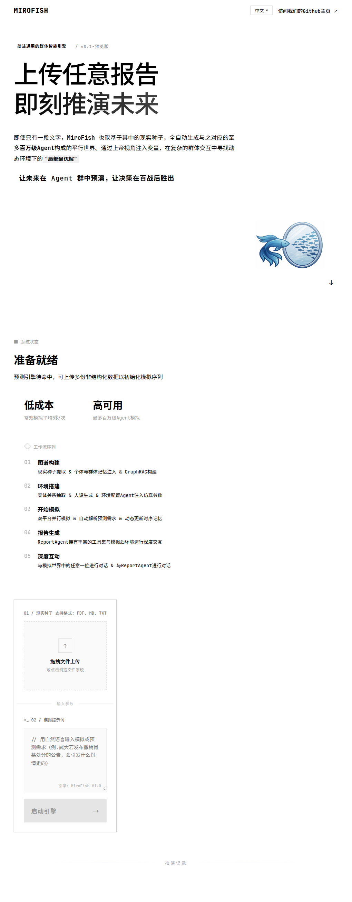
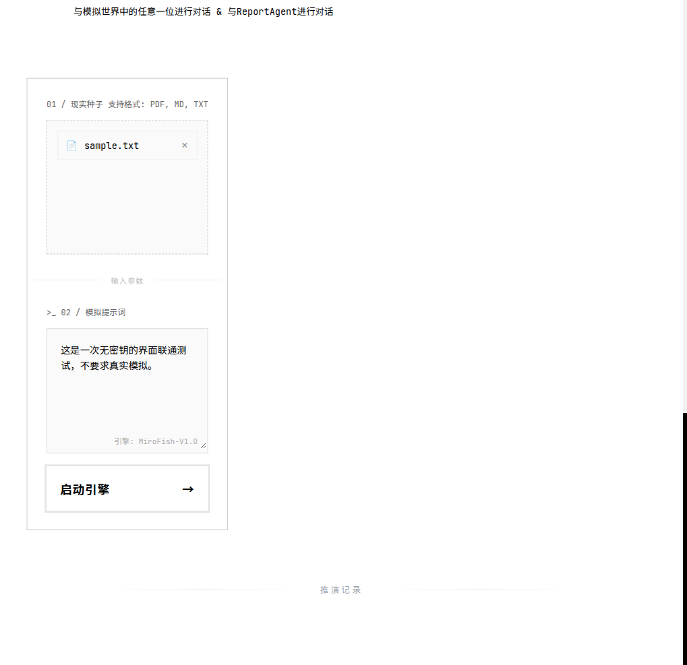
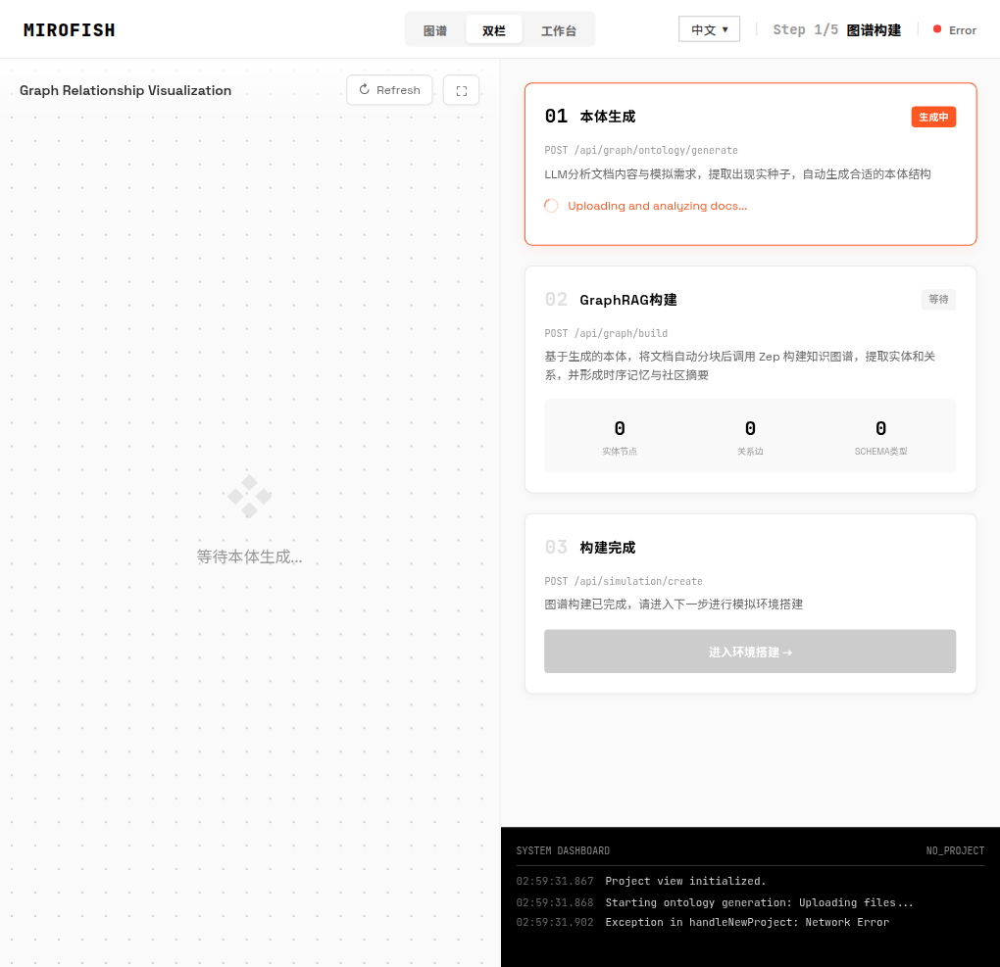

# 云端页面实测

时间：2026-11-17。代码为 main `70962b5`。这是浏览器里的真实页面，与用户电脑上的模型探针无关。云端没有模型凭据，模型调用次数为 0。安全注入没有到达这台主机。

## 启动

前端：

```bash
cd frontend && npm install && npm run dev -- --host 127.0.0.1 --port 3000
```

Vite 7.3.6 在 `http://127.0.0.1:3000/` 返回 HTTP 200。

后端：

```bash
python3 backend/run.py
```

进程退出码 1，控制台为 `LLM_API_KEY 未配置` 与 `ZEP_API_KEY 未配置`。`run.py` 在 `Config.validate()` 失败时退出，`create_app()` 没有执行，5001 没有监听。`GET http://127.0.0.1:5001/health` 连接被拒绝。

## 浏览器里看到的

| 步骤 | 结果 |
| --- | --- |
| 打开首页 | 通过。标题「MiroFish - 预测万物」。界面是上游 MiroFish |
| 上传示例文本并填写提示词 | 通过。「启动引擎」变为可点 |
| 进入 `/process/new` | 失败。Step 1/5，状态 Error |
| `GET /api/simulation/history` 与 `POST /api/graph/ontology/generate` | 失败。浏览器直连 `http://localhost:5001`，`ERR_CONNECTION_REFUSED` |
| 图谱与仿真 | 阻塞。Zep 那一步没有发出请求。实体、关系、SCHEMA 显示为 0，这不是图谱结果 |
| 八字或梅花页面 | 没有。`frontend/src` 没有对应入口 |

页面日志：`Exception in handleNewProject: Network Error`。

首页：



上传并填写之后：



启动后的失败页：



之后在同一页点 Refresh，没有向 5001 发出新请求，错误状态保持不变。那张重复截图没有再放进仓库。
